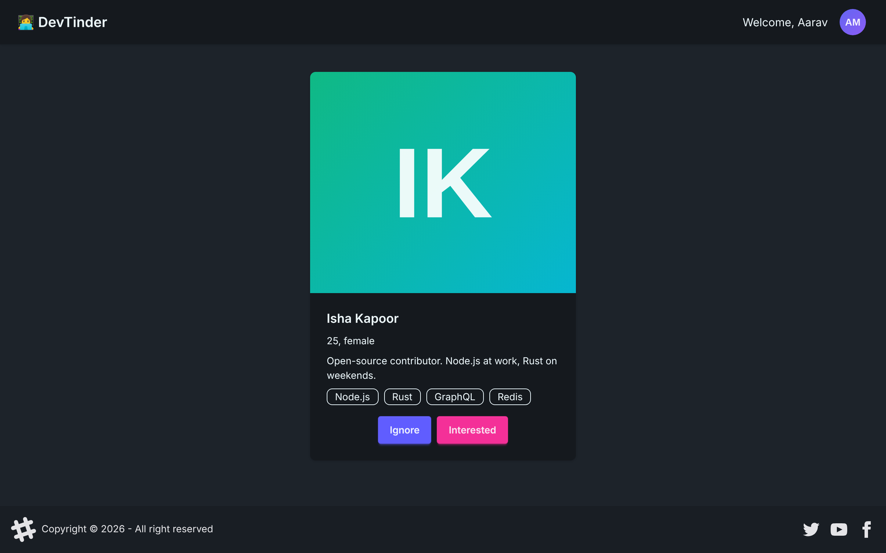
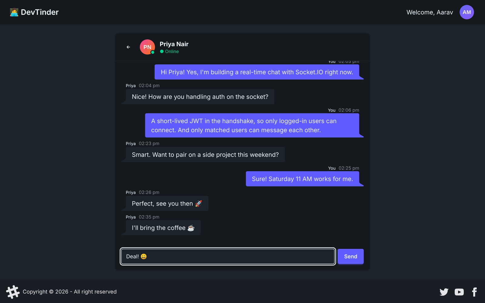
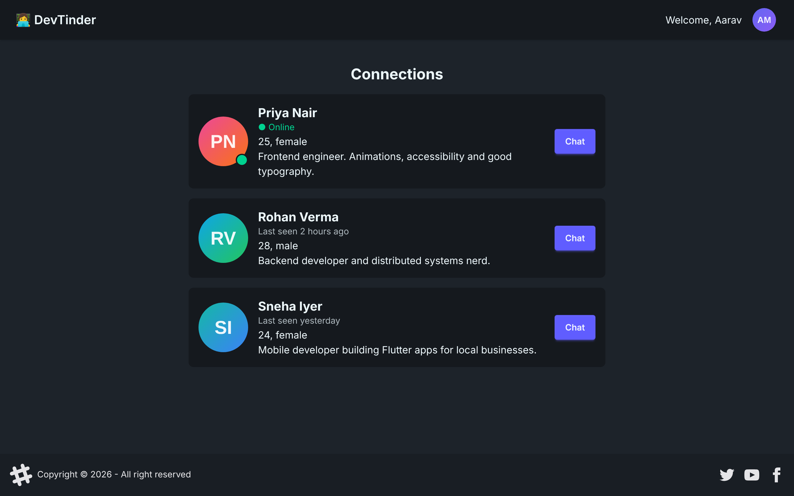
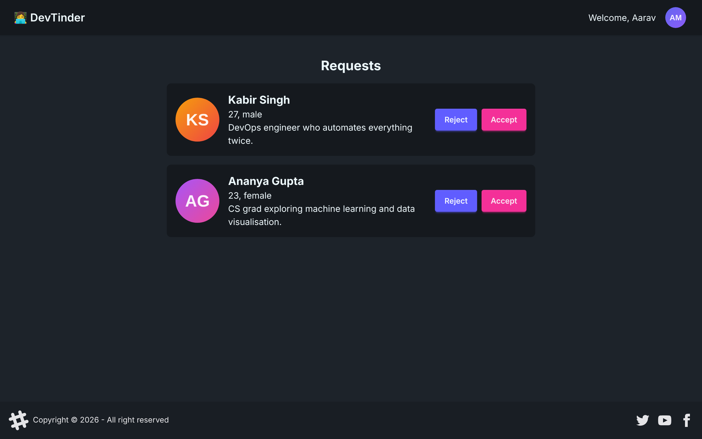
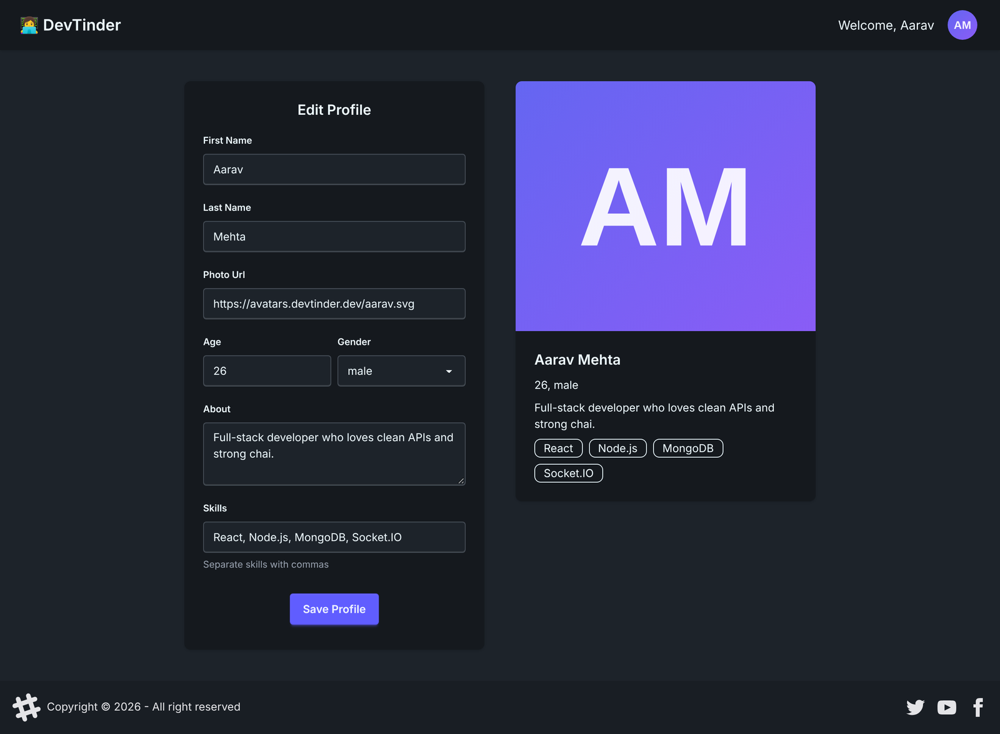
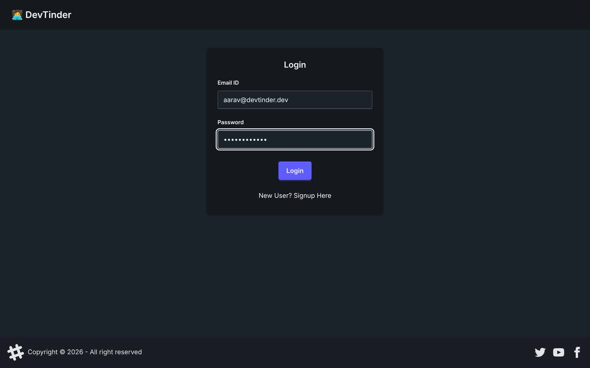
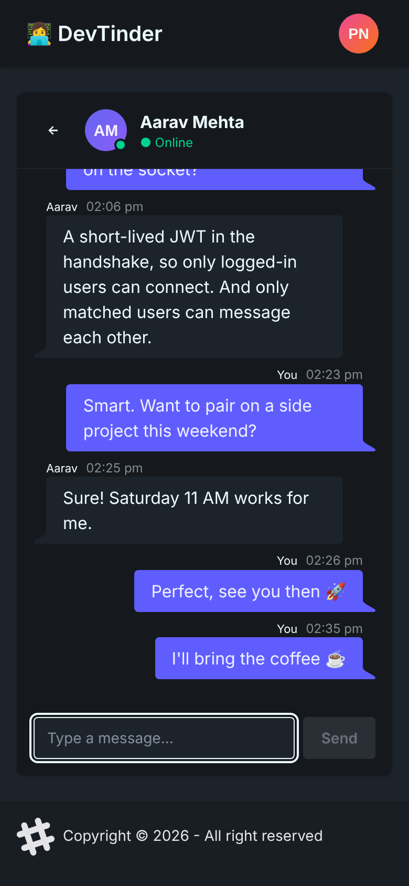
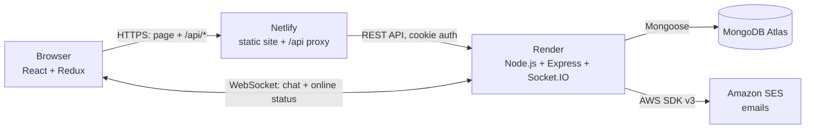
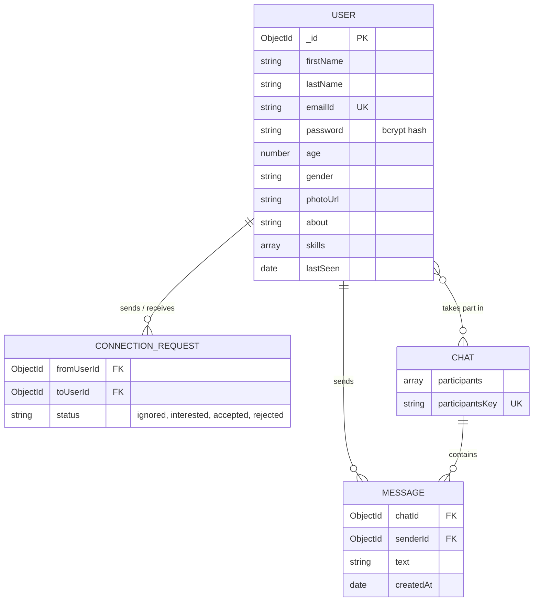

# 👩‍💻 DevTinder

**A full-stack app where developers find each other, match, and chat in real time.** Think Tinder, but for finding someone to build with.


**Live demo:** _add your Netlify link here_

<p>
  
  
</p>

---

## Features

**Accounts.** Sign up and log in with email and password. Passwords are hashed with bcrypt, and the session lives in an `httpOnly` cookie holding a JWT, so page scripts can never read it.

**Profile.** Edit your name, photo, age, gender, bio and skills, with a live preview of the card other developers will see.

**Feed.** Browse developers one card at a time and choose **Interested** or **Ignore**. The feed never shows you yourself or anyone you already have a request with, and it's paginated on the server.

**Requests and matches.** People who are interested in you appear under Requests. **Accept** turns them into a connection.

**Real-time chat.** Matched developers can message each other instantly over WebSockets. Messages are saved, and older ones load 30 at a time.

**Online status.** A green dot shows which connections are online right now; otherwise you see "Last seen 2 hours ago". Only your connections can see this about you.

**Email notifications.** An email goes out when someone is interested in you, plus a daily 8 AM reminder about pending requests (Amazon SES + a cron job).

**Responsive dark UI.** Works on desktop and phone screens.

## Screenshots

| Connections with online status | Connection requests |
|---|---|
|  |  |
| **Edit profile with live preview** | **Login** |
|  |  |

<p align="center">
  
  <br /><em>Chat on a phone screen</em>
</p>

---

## Tech stack

| Area | Tools |
|---|---|
| Frontend | React 19, Vite, Redux Toolkit, React Router, Tailwind CSS 4, daisyUI 5, Axios |
| Backend | Node.js, Express, Mongoose, JSON Web Tokens, bcryptjs, validator |
| Real-time | Socket.IO (server and client) |
| Database | MongoDB Atlas |
| Email and jobs | Amazon SES (AWS SDK v3), node-cron, date-fns |
| Hosting | Netlify (frontend), Render (backend), MongoDB Atlas (database) |

## Architecture



The browser only ever talks to the Netlify address for normal requests. Netlify forwards everything under `/api` to the Express server on Render, so the login cookie is a normal first-party cookie. The one exception is the live chat connection, which goes straight to Render because Netlify's forwarding can't carry WebSockets.

---

## Engineering highlights

These are the problems that took the most thought, and how they were solved.

**1. Login cookies that work across two hosts.** The frontend (Netlify) and backend (Render) live on different domains. A cookie set by the backend's domain counts as a third-party cookie, and Safari blocks those by default. Instead of loosening the cookie to `SameSite=None`, Netlify proxies `/api/*` to the backend. To the browser it's all one site, so the cookie stays `httpOnly`, `SameSite=Lax` and `Secure`.

**2. Authenticated WebSockets.** Because the socket connects straight to Render, it can't use that cookie. The client first calls `GET /socket-token` (authenticated by the cookie) and gets a JWT that lasts 5 minutes and is marked for socket use only. The socket middleware checks it on every connect and reconnect. The sender's identity always comes from the server, never from the message the browser sends, and a user can only join a chat room after the server confirms the two people are actually connected.

**3. Online status and "last seen".** The server keeps an in-memory map of `userId -> number of open tabs`, so closing one of two tabs doesn't mark you offline. When your first tab connects or your last tab closes, the server tells only your connections, through a private room each user joins (`user:<id>`). `lastSeen` is saved to MongoDB when the last tab disconnects.

**4. Chat history that scales.** Each message is its own document instead of one ever-growing array inside the chat. That keeps documents small (MongoDB caps a document at 16 MB), and with a compound index on `{ chatId, _id }` the newest 30 messages are a single indexed query. Older pages use cursor pagination (`?before=<messageId>`), fetching `limit + 1` rows to know whether more exist.

**5. Race conditions in chat.** If both people send their first message at the same moment, two chat documents could be created. A unique `participantsKey` (both user ids, sorted) prevents that, and the losing request retries by reading the chat that now exists. Messages from one user are also processed through a per-socket promise chain, so fast typing can never save them out of order.

**6. Feed and request rules.** The feed excludes everyone you already have a request with, using `$nin` on a set built from your requests, with `skip`/`limit` pagination. Connection requests have a compound index, a `pre("save")` hook that blocks sending a request to yourself, and checks for duplicates in both directions.

**7. Free-tier cold starts.** Render's free plan sleeps after 15 minutes idle and takes about a minute to wake up, which is longer than Netlify's proxy timeout. The app detects this, shows "Waking up the server..." and keeps retrying, instead of showing an error.

**8. Email without getting throttled.** Amazon SES limits how fast you can send. Emails go through a small in-process queue that sends them one at a time with a gap between them, so an API request never waits for an email. User-written text is HTML-escaped before it goes into an email, and the daily job runs on India time even though the server runs on UTC.

---

## API reference

| Method | Endpoint | What it does |
|---|---|---|
| POST | `/signup` | Create an account and log in |
| POST | `/login` | Log in, sets the auth cookie |
| POST | `/logout` | Clear the auth cookie |
| GET | `/profile/view` | The logged-in user's profile |
| PATCH | `/profile/edit` | Update profile fields (allow-listed) |
| GET | `/feed?page=1&limit=10` | Developers you haven't acted on yet |
| POST | `/request/send/:status/:toUserId` | `interested` or `ignored` |
| POST | `/request/review/:status/:requestId` | `accepted` or `rejected` |
| GET | `/user/requests/received` | Pending requests sent to you |
| GET | `/user/connections` | Your matches, with online status and last seen |
| GET | `/chat/:targetUserId?before=<id>` | Chat history, 30 messages per page |
| GET | `/socket-token` | Short-lived token for the WebSocket |
| GET | `/health` | Health check |

**Socket.IO events.** The client sends `joinChat`, `leaveChat` and `sendMessage`. The server sends `messageReceived`, `presenceChanged` and `chatError`.

## Data model



## Project structure

```
devTinder/
├── backend/                 Express API + Socket.IO
│   └── src/
│       ├── app.js           server setup, routes, startup checks
│       ├── config/          MongoDB connection
│       ├── middlewares/     auth (JWT from cookie)
│       ├── models/          User, ConnectionRequest, Chat, Message
│       ├── routes/          auth, profile, request, user, chat
│       └── utils/           socket, presence, email queue, cron, validation
├── frontend/                React + Vite app
│   ├── src/
│   │   ├── components/      Feed, Profile, Requests, Connections, Chat, ...
│   │   └── utils/           Redux slices, socket client, helpers
│   ├── scripts/             writes Netlify's /api proxy rule at build time
│   └── netlify.toml
├── docs/                    setup guide and screenshots
└── package.json             runs backend + frontend together
```

---

## Run it locally

You need **Node.js 22+** and a **MongoDB** connection string (a free [MongoDB Atlas](https://www.mongodb.com/cloud/atlas) cluster works).

```bash
git clone https://github.com/shivampeed/devTinder.git
cd devTinder
cp backend/.env.example backend/.env    # then fill in the values below
npm install                             # installs backend and frontend too
npm run dev                             # API on :7777, app on :5173
```

Open **http://localhost:5173**.

| Variable | Required | Description |
|---|---|---|
| `DB_CONNECTION_SECRET` | Yes | MongoDB connection string |
| `JWT_SECRET` | Yes | Long random string, e.g. `openssl rand -hex 32` |
| `PORT` | No | API port, default `7777` |
| `FRONTEND_URL` | No | Allowed frontend address(es) for CORS |
| `NODE_ENV` | No | `production` on the server, for https-only cookies |
| `AWS_ACCESS_KEY`, `AWS_SECRET_KEY`, `SES_FROM_EMAIL`, `AWS_REGION` | No | Turns on emails |

A step-by-step beginner guide (Atlas setup, troubleshooting, deployment) is in **[docs/SETUP.md](docs/SETUP.md)**.

## Deployment

| Part | Platform | Settings |
|---|---|---|
| Backend | Render web service | Root directory `backend`, build `npm install`, start `npm start`, env vars from the table above |
| Frontend | Netlify | Base directory `frontend` (reads `netlify.toml`), env var `BACKEND_URL` = the Render address |
| Database | MongoDB Atlas | Allow access from `0.0.0.0/0` so Render can connect |

At build time, `BACKEND_URL` becomes the `/api` proxy rule and the chat's WebSocket address, so the frontend code contains no hardcoded server URLs.

## What I'd build next

Typing indicators and read receipts in chat. Photo uploads (S3 or Cloudinary) instead of photo links. A Redis adapter so Socket.IO and online status work across several server instances (today the online list lives in one server's memory). Rate limiting on login and signup. Automated tests with Jest and Supertest for the API, and Playwright for the main user flows.

---

## Author

**Shivam Deep**: [GitHub](https://github.com/shivampeed) · [LinkedIn](https://www.linkedin.com/in/YOUR_PROFILE)
